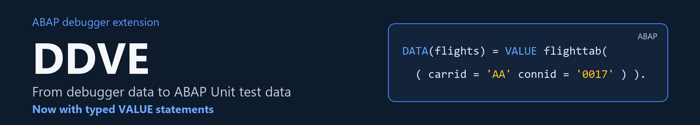
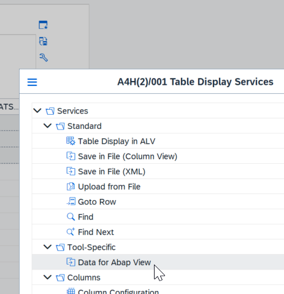
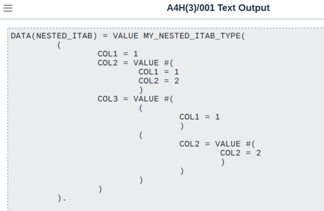
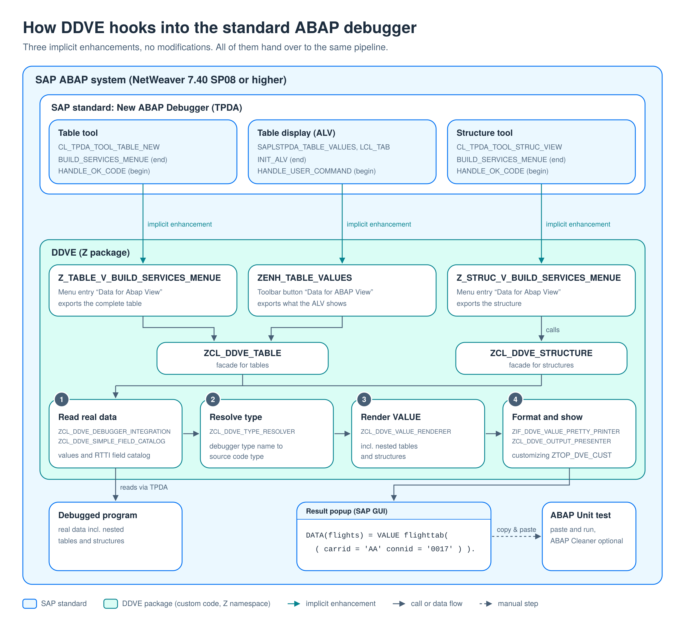

# ABAP Debugger Data View Extension (DDVE)

Turn any internal table or structure you are inspecting in the ABAP debugger into a ready-to-paste `VALUE #( ... )` statement — and cut the most tedious part of writing ABAP Unit tests: creating test data by hand.

```abap
" One click in the debugger turns the content of LT_FLIGHTS into:
DATA(lt_flights) = VALUE tt_flights(
  ( carrid = 'LH' connid = '0400' fldate = '20260115' price = '666.00' currency = 'EUR' )
  ( carrid = 'LH' connid = '0402' fldate = '20260116' price = '471.00' currency = 'EUR' )
  ( carrid = 'AA' connid = '0017' fldate = '20260117' price = '422.94' currency = 'USD' ) ).
```

Copy, paste into your test class, done.

## Why

When you write unit tests for existing code, the realistic test data usually already exists — in the debugger, at the exact spot you are trying to cover. Typing it off the screen field by field is slow and error-prone. This extension adds a menu entry to the debugger's table and structure views that renders the current variable content as a syntactically correct, nicely formatted `VALUE` constructor expression.

## Features

- **Internal tables and structures** — works from both the table view and the structure view of the new ABAP debugger.
- **Nested data** — structures in tables, tables in structures: the renderer recurses through arbitrary nesting.
- **Respects your ALV state** — rows filtered out in the ALV grid and columns you have hidden (`no_out`) are excluded from the generated statement.
- **Real type names** — the type resolver translates internal debugger type names (`\CLASS=...\TYPE=...`) into source-valid type expressions, so the output is `DATA(name) = VALUE zcl_foo=>tt_bar( ... )` instead of a cryptic placeholder. If no valid type can be derived, it falls back to `VALUE #( ... )`.
- **Pretty printing** — a built-in parser formats the expression with indentation that follows the nesting depth. A second printer variant compresses the output to a configurable maximum line length.
- **Per-user customizing** — which pretty printer class is used can be configured per user in table `ZTOP_DVE_CUST` (maintenance views included). You can plug in your own implementation of `ZIF_DDVE_VALUE_PRETTY_PRINTER`.
- **Unit-tested** — the core classes ship with ABAP Unit tests; dependency injection via `ZCL_DDVE_PRET_PRINTER_INJECTOR` keeps the components testable.

## Requirements

- SAP NetWeaver ABAP **7.40 SP08 or higher** (the code base is deliberately kept compatible with 7.40 SP08 so it can be installed on older systems).
- [abapGit](https://abapgit.org) to install.

## Installation

1. Install [abapGit](https://docs.abapgit.org) on your system.
2. Create a package (the repository ships as a local package; `$Z_DEBUGGER_DATA_VIEW_EXT` works fine) and clone this repository into it:
   `https://github.com/gepparta/abap_debugger_data_view_extension.git`
3. Pull and **activate all objects**, including the enhancement implementations (`ZENH_TABLE_VALUES`, `Z_TABLE_V_BUILD_SERVICES_MENUE`, `Z_STRUC_V_BUILD_SERVICES_MENUE`) — they hook the extension into the standard debugger.

## Usage

1. Run the included demo program `Z_DEBUGGER_DATA_VIEW_EXT_DEMO` (or any program of yours) and stop at a breakpoint.
2. Display an internal table or structure in the debugger.
3. Open the **Services of the Tool** menu of the table/structure view — you will find new entries added by this extension (in the ALV table display there is also a toolbar button **Data for ABAP View**).

   

4. The generated `VALUE` statement is displayed in a popup, ready to be copied into your test code.

   

Tip for tables: filter rows and hide columns in the ALV grid first — the generated statement will contain exactly what you see.

## Architecture

<a href="images/Architecture_EN.png"></a>

The extension hooks into the debugger via three implicit enhancements (no modifications) and is otherwise a small, modular class library:

| Component | Role |
| --- | --- |
| `ZENH_TABLE_VALUES`, `Z_TABLE_V_BUILD_SERVICES_MENUE`, `Z_STRUC_V_BUILD_SERVICES_MENUE` | Enhancement implementations — debugger entry points (table and structure view). |
| `ZCL_DDVE_DEBUGGER_INTEGRATION` | Data acquisition: extracts variable content from the debugger context via asXML transformation. |
| `ZCL_DDVE_TABLE` / `ZCL_DDVE_STRUCTURE` | Facades for the table/structure view; apply ALV row filters and hidden columns, build the final statement. |
| `ZCL_DDVE_VALUE_RENDERER` | Rendering engine: builds `VALUE #( ... )` expressions, owns the recursion for nested data. |
| `ZCL_DDVE_COMPONENT` | Formats individual field values. |
| `ZCL_DDVE_TYPE_RESOLVER` | Resolves debugger type names into source-valid type expressions and derives variable names. |
| `ZCL_DDVE_SIMPLE_FIELD_CATALOG` | Simplified field catalog for DDIC and local types, resolves `.INCLUDE`s recursively. |
| `ZIF_DDVE_VALUE_PRETTY_PRINTER` | Abstraction for pretty printer implementations. |
| `ZCL_DDVE_VALUE_PRETTY_PRINTER` / `ZCL_DDVE_MAX_LINE_LENGTH_PP` | Formatting engines: indented output / compressed to a maximum line length. |
| `ZCL_DDVE_PRETTYPRINTER_FACTORY` + `ZCL_DDVE_PP_CUSTOMIZING` + `ZTOP_DVE_CUST` | Per-user selection of the pretty printer implementation. |
| `ZCL_DDVE_OUTPUT_PRESENTER` | Output: wraps `cl_demo_output` for display. |
| `ZCL_DDVE_PRET_PRINTER_INJECTOR` | Dependency injection for unit tests. |

Data flow: debugger enhancement → data acquisition (asXML) → ALV filter → printer selection (customizing) → rendering → display.

## Background

The idea, the original implementation and its evolution are described in these articles (newest first):

- [ABAP Debugger Enhancement — Reloaded](https://www.linkedin.com/pulse/abap-debugger-enhancement-reloaded-alexander-geppart-0spde/) (LinkedIn, 2026)
- [DDVE-Update: typisierte VALUE-Anweisungen](https://www.t5-c.de/wissen/ddve-update-typisierte-value-anweisungen/) (German, 2026)
- [ABAP Debugger Enhancement — Update](https://community.sap.com/t5/application-development-and-automation-blog-posts/abap-debugger-enhancement-update/ba-p/13391425) (SAP Community, 2019)
- [ABAP debugger enhancement — or how to speed up your test data creation process](https://community.sap.com/t5/application-development-and-automation-blog-posts/abap-debugger-enhancement-or-how-to-speed-up-your-test-data-creation/ba-p/13325606) (SAP Community, 2017)

Related community posts:

- [Speed up regression tests with the ABAP debugger](https://community.sap.com/t5/application-development-and-automation-blog-posts/speed-up-regression-tests-with-the-abap-debugger/ba-p/13425592) — uses this tool to generate test data for regression tests (2019)
- [Fork of ABAP Debugger Data View Extension tool](https://community.sap.com/t5/application-development-and-automation-blog-posts/fork-of-abap-debugger-data-view-extension-tool/ba-p/13507616) — a community fork with performance and robustness improvements

## License

Licensed under the [Apache License 2.0](LICENSE).
